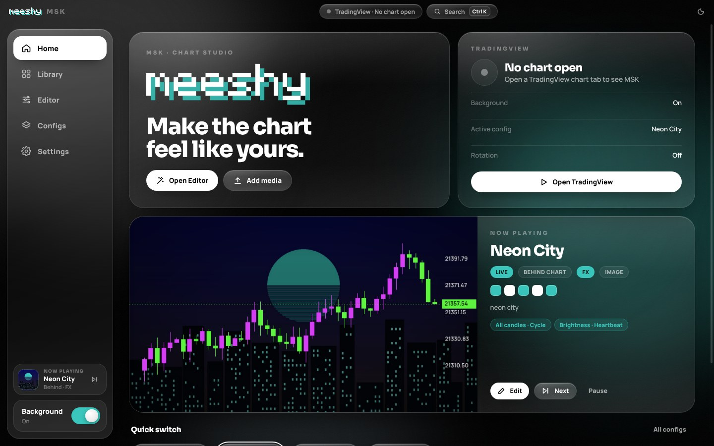
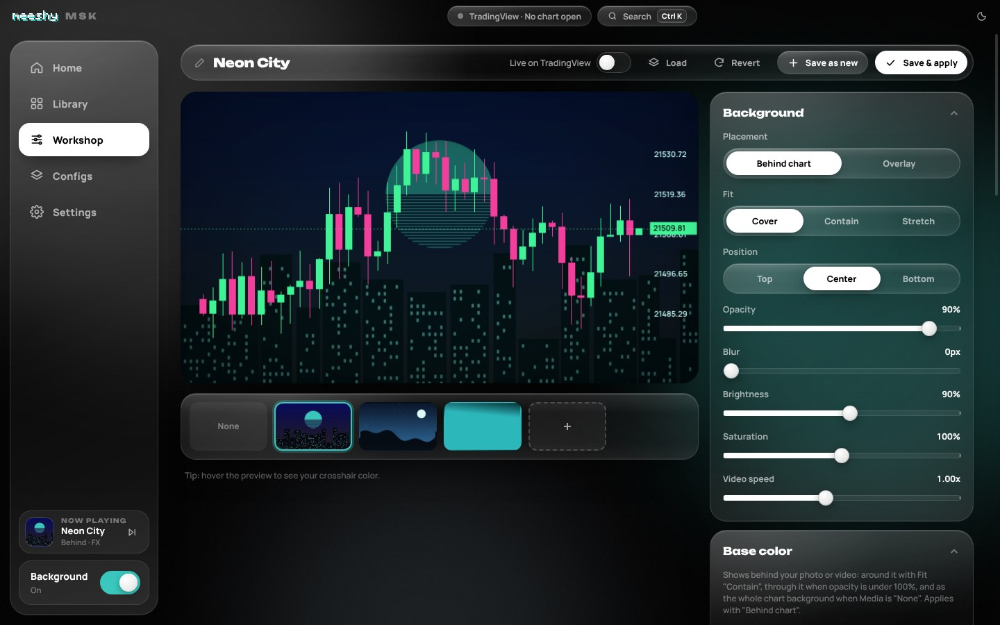
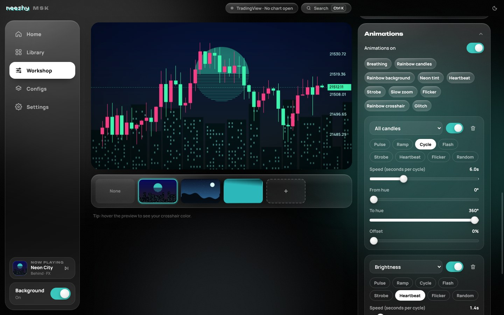
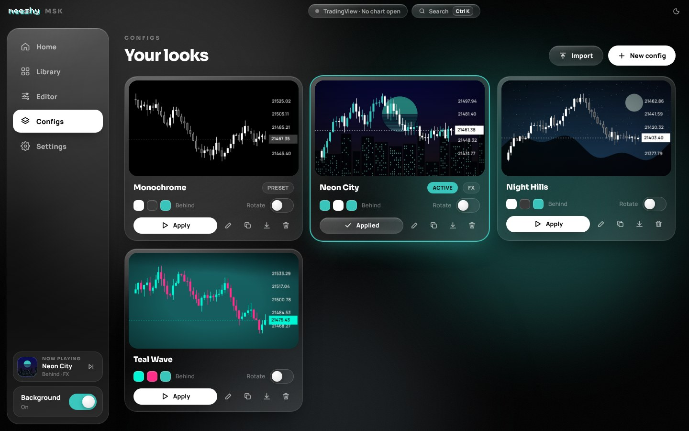
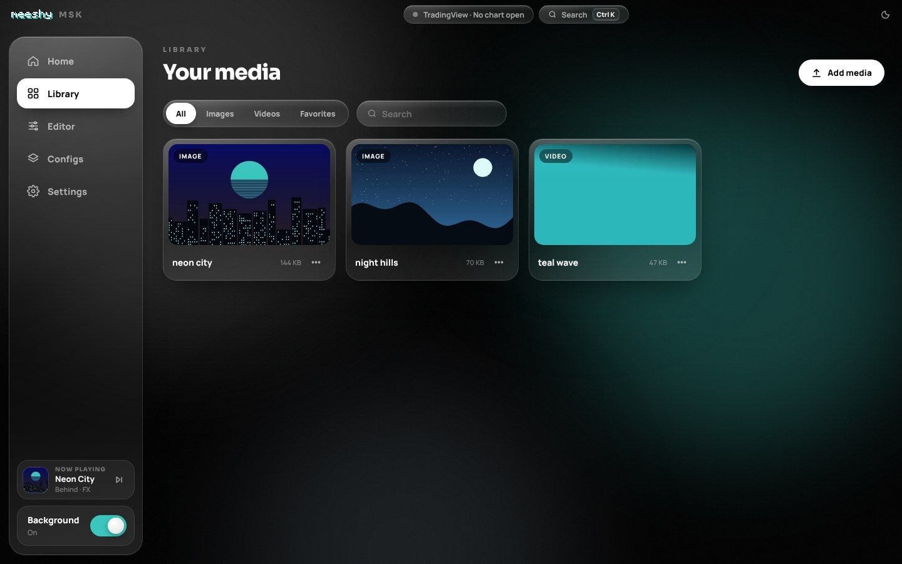
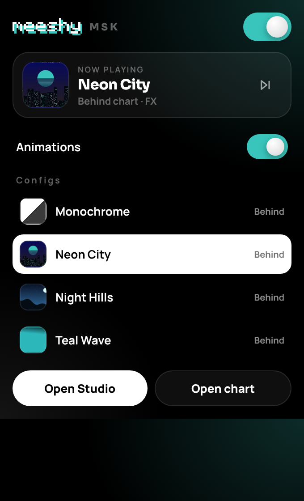

  

  
  
  
  

<h3 align="center">Photo & video backgrounds, custom candle colors and animations for TradingView.</h3>

No account. No paywall. Everything stays in your browser.

  <b>Using the TradingView Desktop app?</b> Grab the app version → <a href="https://github.com/meeshyweeshy/msk-desktop"><b>msk-desktop</b></a>

 

  

## ✦ What it does

| | |
|---|---|
| 🖼️ **Backgrounds** | Put any photo, GIF or video behind (or over) your chart. Fit, blur, brightness, saturation, tint and vignette. |
| 🎨 **Base color** | Solid, gradient, or TradingView's own theme behind your media. Or skip media and just color the chart. |
| 🕯️ **Candle colors** | Recolor bodies, borders, wicks, grid, scale text and crosshair. Presets like Mono, Miku, Classic, Neon. |
| ✨ **Animations** | Make anything move: pulse, flash, strobe, heartbeat, flicker, rainbow cycling. Stack as many as you want. |
| 🗂️ **Configs** | Save looks, switch in one click, auto-rotate on a timer, export/import `.msk` files (media included). |
| ⚡ **Fast** | Live preview, instant apply on every open chart tab, `Ctrl+K` command palette, keyboard shortcuts. |

## ✦ Preview

<table>
  <tr>
    <td width="50%">
<b>Workshop</b>: build a look with a live preview
</td>
    <td width="50%">
<b>Animations</b>: rainbow candles, heartbeat, strobe…
</td>
  </tr>
  <tr>
    <td width="50%">
<b>Configs</b>: all your looks, one click to apply
</td>
    <td width="50%">
<b>Library</b>: drag & drop photos and videos
</td>
  </tr>
</table>

 The toolbar popup: on/off, animations, quick config switching

## ✦ Install

1. **Download** this repo: green **Code** button → **Download ZIP**.
2. **Unzip** it somewhere it can stay (don't delete the folder after installing).
3. Open your extensions page: `chrome://extensions`, `brave://extensions` or `edge://extensions`.
4. Turn on **Developer mode** (top right).
5. Click **Load unpacked** and pick the unzipped folder (the one with `manifest.json` in it).
6. Click the 🧩 puzzle icon and **pin MSK** to your toolbar.

## ✦ Quick start

1. Click the MSK icon → **Open Studio**.
2. **Library** → drag in a photo or video.
3. **Workshop** → pick it, choose **Behind chart**, tweak the look, add animations if you want.
4. **Save & apply**, then open any `tradingview.com/chart` tab. Done.

> Tip: flip on **Live on TradingView** in the Workshop to see changes on your chart while you edit.

## ✦ Shortcuts

| Keys | Does |
|---|---|
| `Alt` `Shift` `B` | Background on / off |
| `Alt` `Shift` `N` | Next config |
| `Alt` `Shift` `F` | Pause / resume animations |
| `Ctrl` `K` | Command palette (inside the Studio) |

Change them at `chrome://extensions/shortcuts`.

## ✦ Updating

Download the new ZIP, replace your old folder's files, then hit the ↻ reload button on MSK in your extensions page. Your media and configs stay.

## ✦ FAQ

**Is it free?** Yes. Fully. No account, no sign-in, no subscription.

**Where's my stuff stored?** Inside your browser (extension storage). Nothing is uploaded anywhere.

**Candle colors didn't change?** Make sure **Recolor the chart** is on in the Workshop. TradingView's internals aren't public, so colors are best-effort. Backgrounds always work.

**Is there a desktop app?** Yes: **[msk-desktop](https://github.com/meeshyweeshy/msk-desktop)** works with TradingView Desktop on Windows, with a tray icon, startup launch and global hotkeys.

**Can I move configs to the desktop app?** Yes. Configs export as `.msk` files (with the media inside) and import into either one.

## ✦ About

MSK started as a "can I put my own wallpaper behind TradingView?" idea and turned into a full chart-skins studio: a [desktop app](https://github.com/meeshyweeshy/msk-desktop) for TradingView Desktop plus this browser extension. Built by **meeshy** for traders who stare at charts all day and want them to actually look good.

Not affiliated with TradingView. Use it however you like.

